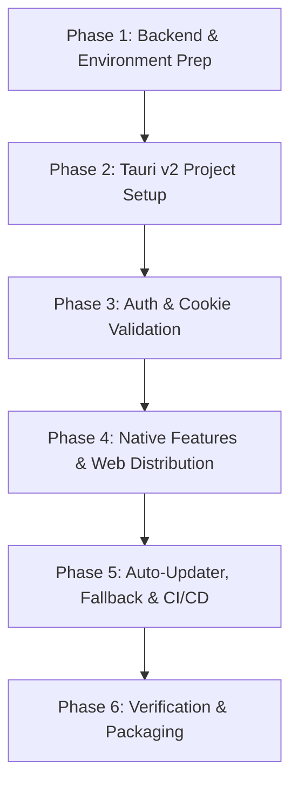

# Implementation Plan: DriveBase Desktop Application (Windows) with Tauri v2

## 1. Executive Summary & Goals

The objective is to package the existing **Vite + React 19 + TypeScript** frontend into a lightweight, professional **Windows Desktop Application** for dealership managers, while keeping the **Cloud Web Application** completely intact and functional.

### Key Objectives
1. **Local Asset Execution**: The heavy client bundle (React, CSS, images, icons) runs directly on the manager's Windows PC, eliminating slow UI asset downloads over sluggish dealership internet connections.
2. **Dual-Target Codebase**: One unified frontend codebase powers **both** the Web App (cloud) and Desktop App (Tauri) with zero divergence.
3. **Seamless Auth & Cookie Bridge**: Ensure Django session cookies and CSRF protection work cleanly across desktop and web.
4. **Unblocked Multi-PDF Generation**: Open all 3 contract/invoice PDFs simultaneously into native Windows viewers or save directly to disk without browser popup blockers.
5. **Zero-Friction In-App Updates**: Use GitHub Actions and GitHub Releases to silently deliver updates to managers when you push code to GitHub.

---

## 2. Technology Stack & Architectural Decision

### Why Tauri v2 (Not Electron)?
- **Toolchain Status**: `cargo 1.83.0` and `rustc 1.83.0` are **already installed and verified** on this Windows environment.
- **Installer Size**: ~10–15 MB installer (vs ~150 MB for Electron).
- **RAM Footprint**: ~35–50 MB RAM (vs 300+ MB for Electron).
- **Native Engine**: Uses Windows Edge WebView2 (built into Windows 10/11), so managers don't need to install extra runtimes.
- **Native Security & HTTP**: Native OS networking bypasses webview CORS/cookie restrictions and popup blockers.

```
                    +--------------------------------------------------+
                    |               Cloud Infrastructure               |
                    |                                                  |
                    |   +------------------------------------------+   |
                    |   |        Django Backend (Ninja API)        |   |
                    |   |         https://api.yourcloud.com        |   |
                    |   +------------------------------------------+   |
                    |                        ^                         |
                    +------------------------|-------------------------+
                                             |
                     +-----------------------+-----------------------+
                     | HTTPS API Requests                            | HTTPS API Requests
                     | (Cookies / CSRF)                              | (Native HTTP / Cookies)
                     v                                               v
        +-------------------------+                     +-------------------------+
        |     Cloud Web Client    |                     |   Desktop App (Tauri)   |
        |  (Browser: Chrome/Edge) |                     |   (Manager Windows PC)  |
        |                         |                     |                         |
        | - Loaded from Cloud CDN |                     | - UI Assets Bundled     |
        | - Standard Browser Tabs |                     |   Locally on Disk       |
        |                         |                     | - Native Multi-PDF Open |
        |                         |                     | - Auto-Updates via      |
        |                         |                     |   GitHub Releases       |
        +-------------------------+                     +-------------------------+
```

---

## 3. Core Architectural Solutions

### A. Authentication, Cookies, & CSRF Resolution
- **The Challenge**: `document.cookie` in a local webview (`http://tauri.localhost`) cannot read cookies set by the remote domain `https://api.yourcloud.com`.
- **The Solution**:
  1. **Dual Token Delivery in Backend**:
     In `backend/drivebase/urls.py`, enhance `get_csrf_token()` so that in addition to setting the cookie via `@ensure_csrf_cookie`, it also returns the CSRF token directly in the response body:
     ```python
     from django.middleware.csrf import get_token
     
     @ensure_csrf_cookie
     def get_csrf_token(request):
         return JsonResponse({
             "detail": "CSRF cookie set",
             "csrfToken": get_token(request)
         })
     ```
  2. **Smart Frontend CSRF Storage**:
     In `frontend/src/lib/api.ts`, `ensureCsrfToken()` will check `document.cookie`. If empty (running in desktop), it uses `response.data.csrfToken` stored in memory / `sessionStorage`.
  3. **Backend CORS & CSRF Origins**:
     In `backend/drivebase/settings.py`, add:
     ```python
     CORS_ALLOWED_ORIGINS = [
         "http://localhost:5173",
         "http://127.0.0.1:5173",
         "http://localhost:3000",
         "http://tauri.localhost",
         "https://tauri.localhost",
     ]
     CSRF_TRUSTED_ORIGINS = [
         "http://localhost:5173",
         "http://127.0.0.1:5173",
         "http://localhost:8000",
         "http://127.0.0.1:8000",
         "http://tauri.localhost",
         "https://tauri.localhost",
     ]
     ```
  4. **Cookie Persistence**:
     Enable Tauri's native cookie jar or webview credential persistence so session cookies (`sessionid`) persist between app relaunches.

---

### B. Environment & API Base URL Configuration
- **The Challenge**: Currently `frontend/src/lib/api.ts` hardcodes `baseURL: "/api"`.
- **The Solution**:
  - Update `api.ts`:
    ```typescript
    const API_BASE = import.meta.env.VITE_API_BASE_URL || "/api"
    const api = axios.create({
        baseURL: API_BASE,
        headers: { "Content-Type": "application/json" },
        withCredentials: true,
    })
    ```
  - For **Web Builds**: `.env.production` sets `VITE_API_BASE_URL=""` (or relative `/api`).
  - For **Desktop Builds**: `.env.desktop` sets `VITE_API_BASE_URL="https://api.yourcloud.com/api"` (or a configurable cloud backend URL).

---

### C. Multi-PDF Document Generation (Eliminating Popup Blockers)
- **The Challenge**: In `ContractModal.tsx`, generating contracts triggers up to 3 PDFs at once. Modern browsers block tabs 2 and 3 as unwanted popups.
- **The Solution**:
  - Create a helper utility `openOrDownloadPdf(pdf: PdfEntry)`:
    - **In Browser (Web)**: Keeps current fallback behavior (new tab + fallback download buttons).
    - **In Desktop (Tauri)**: Uses Tauri's `@tauri-apps/plugin-shell` and `@tauri-apps/plugin-fs`. It downloads all 3 PDF byte streams in parallel to a local temp folder or `Downloads/ACAR_Contracts/`, then calls `shell.open(filePath)`.
    - **Result**: Windows immediately opens all 3 PDFs in the user's default PDF viewer (Adobe Acrobat, Foxit, Edge) with zero prompts or blocking!

---

### D. Automated In-App Updates via GitHub Actions
- **The Challenge**: Managers must always have the latest version without manually downloading installers.
- **The Solution**:
  1. Add `@tauri-apps/plugin-updater` to the project.
  2. Configure `tauri.conf.json` with your GitHub repo endpoint:
     `https://github.com/<owner>/<repo>/releases/latest/download/latest.json`
  3. Create a GitHub Actions workflow (`.github/workflows/release-desktop.yml`):
     - Trigger: Pushing a tag like `v1.0.1` or manual workflow dispatch.
     - Action: Builds Vite frontend, runs `cargo tauri build`, creates Windows `.msi` and `.exe`, generates the update signature, and attaches artifacts to a GitHub Release.
  4. App Startup Hook:
     On app launch, a non-intrusive hook checks for updates:
     ```typescript
     import { check } from '@tauri-apps/plugin-updater';
     const update = await check();
     if (update?.available) {
       await update.downloadAndInstall();
        // Notify user: "Update ready! Restart to apply."
      }
      ```

---

### E. Web-to-Desktop Distribution & Permanent Latest URL
- **The Concept**: Dealership staff should never have to ask the admin for an installer file. Anyone accessing the web version should be able to download the desktop app instantly.
- **Permanent Latest Download Link**:
  - GitHub Releases maintains a permanent redirect to the latest `.exe`:
    `https://github.com/<owner>/<repo>/releases/latest/download/ACAR_Setup.exe`
  - Configurable via `VITE_DESKTOP_DOWNLOAD_URL` in frontend environment config.
- **UI Distribution Touchpoints**:
  1. **Login Page**: Clean *"Download DriveBase for Windows"* link/button below the login form.
  2. **Top Navigation / User Menu**: *"Download Desktop App"* button/menu item.
- **Smart Auto-Hiding**:
  - Using an `isTauri()` utility check (`window.__TAURI_INTERNALS__ !== undefined`), these download buttons are **strictly hidden when running inside the desktop app**, keeping the desktop interface native and clutter-free.

---

### F. Resilience, Update Failures & Emergency Fallback
- **The Challenge**: If dealership internet drops mid-update or if an extreme breaking change causes communication issues with the cloud backend, the manager must never be stranded or locked out of their dealership workflow.
- **Atomic Safety**:
  - Tauri's `@tauri-apps/plugin-updater` is atomic: it downloads and validates the signature in a staging directory. If an update fails, corrupts, or disconnects, the existing version remains untouched and operational.
- **Emergency Fallback Screen & Error Boundary**:
  - Implement a dedicated desktop error fallback inside the app layout.
  - If a fatal error or network disconnect occurs, the screen displays:
    1. Clear explanation: *"Connection or version error encountered."*
    2. **[Open Web Version]** button: Invokes `shell.open("https://app.yourdealership.com")` to immediately open their browser so they can continue vehicle sales/contracts without downtime.
    3. **[Download Latest Version]** button: Directly downloads the latest `.exe` from the permanent GitHub release URL.

---

## 4. Phased Implementation Roadmap



### Phase 1: Backend & Environment Configuration
- [ ] In `backend/drivebase/urls.py`, update `get_csrf_token` to return `csrfToken` in JSON body.
- [ ] In `backend/drivebase/settings.py`, whitelist `http://tauri.localhost` in `CORS_ALLOWED_ORIGINS` and `CSRF_TRUSTED_ORIGINS`.
- [ ] In `frontend/src/lib/api.ts`, configure dynamic `VITE_API_BASE_URL` and support body-based CSRF fallback.

### Phase 2: Tauri v2 Integration
- [ ] Initialize Tauri in the `frontend` directory using `@tauri-apps/cli`.
- [ ] Configure `src-tauri/tauri.conf.json`:
  - App Identifier: `com.drivebase.dealership`
  - Window title: `DriveBase Dealership Management`
  - Minimum window size: `1280x800`
  - Webview URL pointing to Vite dev/dist.
- [ ] Add app icons (Windows `.ico` and `.png`).
- [ ] Add `npm run tauri:dev` and `npm run tauri:build` scripts to `frontend/package.json`.

### Phase 3: Auth & API Client Verification
- [ ] Verify login flow in desktop mode against local/cloud backend.
- [ ] Verify session persistence across application restarts.
- [ ] Ensure `withCredentials` sends authentication cookies properly.

### Phase 4: Native Features & Web Distribution
- [ ] Install Tauri plugins: `@tauri-apps/plugin-shell`, `@tauri-apps/plugin-fs`, `@tauri-apps/plugin-dialog`.
- [ ] Implement `frontend/src/lib/desktop/platform.ts` (`isTauri()`, download URL helpers).
- [ ] Implement `frontend/src/lib/desktop/pdfHandler.ts` that detects environment (`isTauri()`).
- [ ] Update `ContractModal.tsx` to use the native handler when on desktop.
- [ ] Add Desktop App download button to `LoginPage.tsx` (auto-hidden on desktop).
- [ ] Add Desktop App download action to Navbar / User Profile menu (auto-hidden on desktop).

### Phase 5: Auto-Updater, Fallback & CI/CD
- [ ] Configure `@tauri-apps/plugin-updater` and generate updater signing keys (`tauri signer generate`).
- [ ] Add GitHub Actions workflow `.github/workflows/release-desktop.yml`.
- [ ] Add in-app update check in layout/app startup.
- [ ] Add Desktop Emergency Fallback screen / Error Boundary with "Open in Web Browser" and "Download Latest Installer" actions.

### Phase 6: End-to-End Verification & Production Build
- [ ] Run full test suite to confirm **Web App** is 100% unaffected (`npm run build`).
- [ ] Build Windows installer (`.exe` / `.msi`).
- [ ] Test installation, offline asset rendering, live cloud data fetching, and PDF opening on Windows.

---

## 5. Potential Risks & Mitigation

| Risk | Mitigation |
| :--- | :--- |
| **Windows SmartScreen warning on install** | Windows flags new `.exe` files until reputation is established. Provide a 1-page guide for managers showing "More info -> Run anyway" (standard for internal tools). |
| **Breaking Web App while adding Desktop features** | Use runtime checks (`window.__TAURI_INTERNALS__`) so desktop code is only invoked in desktop mode; web falls back to standard browser behavior. |
| **Session timeout on poor connections** | Use existing TanStack Query caching and implement retry interceptors in `api.ts` to handle transient network disconnects gracefully. |
